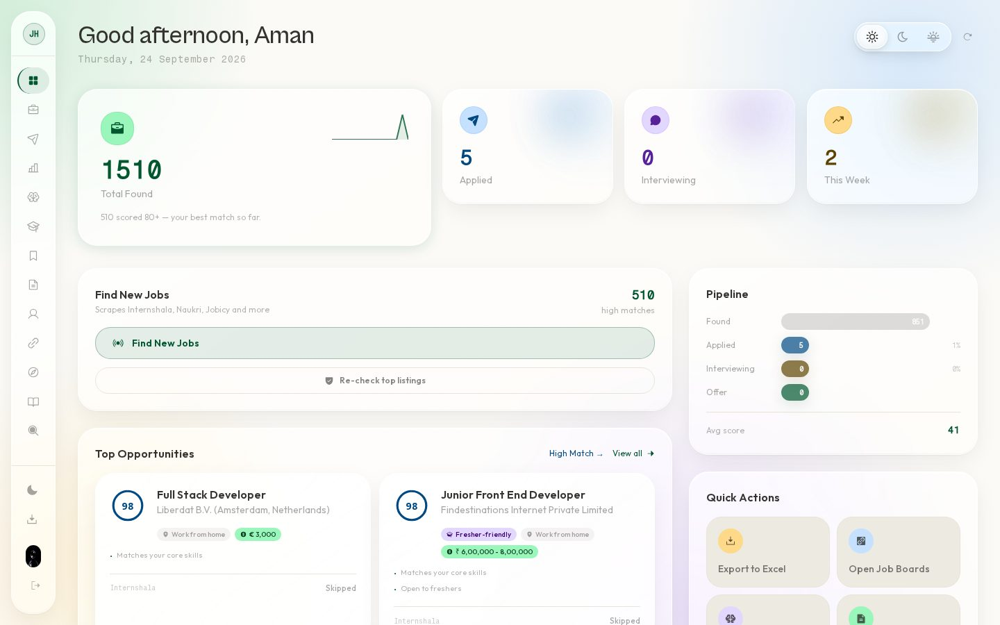
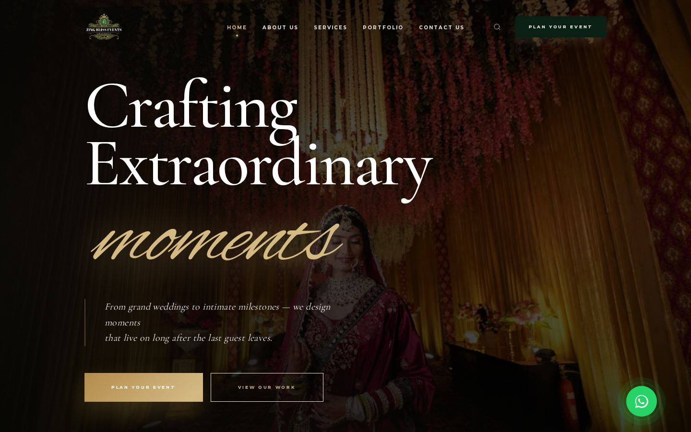

## Aman Patel

Full-stack engineer in Ahmedabad, India. I build web products end to end with React, Next.js, TypeScript and Python: multi-tenant SaaS, LLM-powered tools, and production marketing sites for clients.

Currently a Full Stack Developer Intern at Gravity Multi Media Marketing (since January 2026), where I have shipped 12+ client web applications. B.E. in Electronics and Communications Engineering, L.D. College of Engineering, 2026 (CGPA 8.67).

**Open to** full-stack and AI engineering roles, remote or in Ahmedabad.
[Portfolio](https://portfolio-1byaman.vercel.app) · [LinkedIn](https://www.linkedin.com/in/aman-patel-88847a265) · [Email](mailto:patelaman0241@gmail.com)

### Selected work

<table>
<tr>
<td width="50%" valign="top">

 <b><a href="https://github.com/Aman241104/job-search">Job Search OS</a></b>
 AI job search platform: scrapes 19 job boards, scores listings against a resume, writes a tailored one-page CV and cover letter per job, and tracks applications. FastAPI on Cloud Run, Next.js, Postgres.
</td>
<td width="50%" valign="top">

 <b><a href="https://whatsapp-ai-agent-inky.vercel.app">Pulse AI</a></b>
 Multi-tenant WhatsApp Business AI agent: each business runs an LLM agent on its own number, with bookings, broadcasts and follow-up sequences. Next.js, Supabase with row-level security, Groq.
</td>
</tr>
<tr>
<td width="50%" valign="top">

 <b><a href="https://www.zingblissevents.com">Zing Bliss Events</a></b>
 Production site for an event agency: marketing pages, client-preference quiz, private client portal and admin CMS, with GSAP and Lenis motion. Next.js 16.
</td>
<td width="50%" valign="top">

 <b><a href="https://ares-web-nine.vercel.app">ARES Business League</a></b>
 Live league site for a business network: real-time standings, weekly metrics and an AI assistant. One of 30+ client and practice sites I have designed and deployed.
</td>
</tr>
</table>

More projects: [Gym Tracker](https://github.com/Aman241104/gym-app) (progressive-overload coach) · [Inventory Manager](https://github.com/Aman241104/inventory-manager) (lot-based stock ledger) · [Outreach Automation](https://github.com/Aman241104/outreach) (n8n + Airtable lead pipeline) · [DevEvents](https://github.com/Aman241104/next_js_demo) · [Sweet Shop TDD kata](https://github.com/Aman241104/kata_sweet_shop)

### Tools I work with

**Frontend:** React, Next.js, TypeScript, Tailwind CSS, GSAP, Framer Motion, Three.js
**Backend:** Python, FastAPI, Node.js, Express, REST, Server-Sent Events
**Data:** PostgreSQL, Supabase, MongoDB, MySQL
**AI:** LLM APIs (Gemini, Claude, NVIDIA NIM, Groq), retrieval-augmented generation, tool calling
**Infrastructure and testing:** Docker, Google Cloud Run, Vercel, Cloudflare Workers, Pytest, Vitest, Playwright
