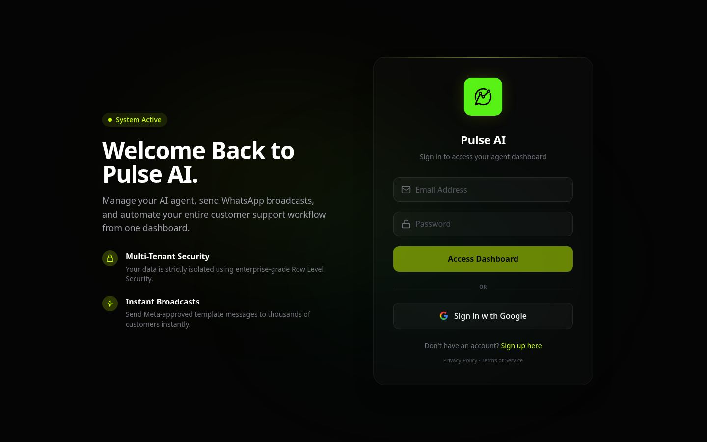
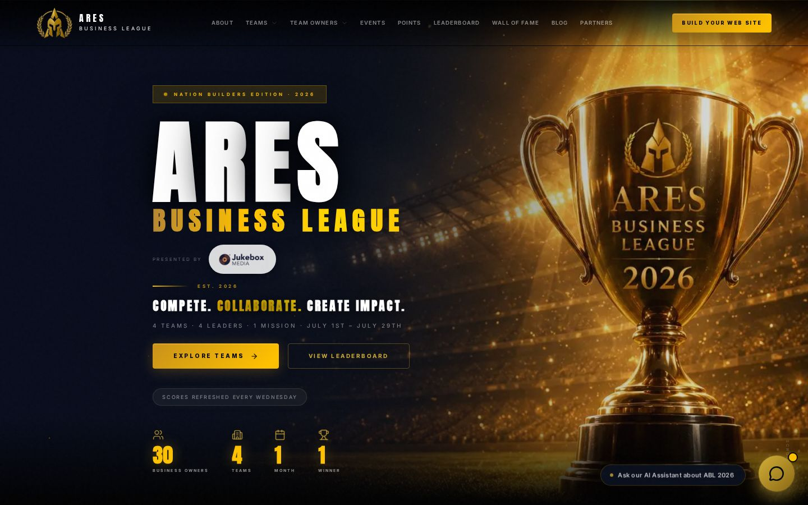

<a href="https://www.aman-patel.me">
  <picture>
    <source media="(prefers-color-scheme: dark)" srcset="assets/header-dark.svg" />
    <source media="(prefers-color-scheme: light)" srcset="assets/header-light.svg" />
    
  </picture>
</a>

I'm a curious kid with an engineering degree. I studied Electronics & Communication at L.D. College of Engineering and taught myself computer science alongside it. I started as a designer, moved into web, then full-stack, and now I'm learning AI engineering and ML. Whatever sparks my curiosity, I learn it and ship it.

The clients I love most arrive with a creative idea, a new way to tackle a problem. I'm the developer who makes it real.

**Now** &nbsp;Full Stack Engineer at Gravity Multi Media Marketing, Ahmedabad (since Jan 2026) · open to full-stack and AI engineering roles, remote or in Ahmedabad 
**Learning** &nbsp;AI engineering and ML: retrieval, tool-calling agents, evals 
**Ask me about** &nbsp;3D on the web (Three.js / R3F), multi-tenant SaaS, shipping client sites that stay up 
**Outside code** &nbsp;hip-hop, films (Akira forever), bikes

 

### Selected work

<table>
<tr>
<td width="50%" valign="top">

 <b><a href="https://job-search-zeta-ten.vercel.app/demo">Job Search OS</a></b> · <a href="https://github.com/Aman241104/job-search">code</a>
 AI job search platform: scrapes 19 job boards, scores listings against a résumé, writes a tailored CV and cover letter per job, and tracks applications. FastAPI on Cloud Run, Next.js, Postgres.
</td>
<td width="50%" valign="top">

 <b><a href="https://whatsapp-ai-agent-inky.vercel.app/demo">Pulse AI</a></b>
 Multi-tenant WhatsApp Business AI agent: each business runs an LLM agent on its own number, with bookings, broadcasts and follow-up sequences. Next.js, Supabase with row-level security, Groq.
</td>
</tr>
<tr>
<td width="50%" valign="top">

 <b><a href="https://www.zingblissevents.com">Zing Bliss Events</a></b>
 Event agency platform: marketing site, client-preference quiz, private client portal and admin CMS, with GSAP and Lenis motion. Next.js.
</td>
<td width="50%" valign="top">

 <b><a href="https://www.aresbusinessleague.com">ARES Business League</a></b>
 A one-month tournament of 30 BNI business owners in 4 teams: live standings, weekly metrics and an AI assistant. Next.js.
</td>
</tr>
</table>

### In production today

Client sites I built that are live on their own domains: 
[Zing Bliss Events](https://www.zingblissevents.com) · [BNI Ares](https://www.bniares.com) · [Vitlead](https://www.vitlead.com) · [Naam Transfer](https://www.naamtransfer.com) · [CMJ Events](https://www.clubmjevents.com) · [Prihaan Spices](https://www.prihaanspices.in) · [Aayush Packaging](https://www.aayushpackaging.in) · [Ekam by Seri](https://www.ekambyseri.com) · [Aangan Boutique](https://www.aanganboutique.in) · [Fibre Glass Processors](https://fgpind.com) · [Rising Rechargeable](https://www.risingrechargeable.com) · [NexSphere Global Advisors](https://www.thenexsphereglobal.com) · [Styluxe Interior Decor](https://www.sidecor.in) · [SV Space Designs](https://www.svspacedesigns.in) · [Chahana Dental Studio](https://chahanadentalstudio.com) · [Classic Organic Chemicals](https://www.classicorganicchemicals.com) · [Silver Spoon by ACJ](https://www.silverspoonbyacj.com) · [Prihaan Financial Services](https://prihaanfin.com) · [ARES Business League](https://www.aresbusinessleague.com) · [Amee Patel](https://www.ameepatel.co.in) · [Jukebox Media](https://www.jukeboxmedia.in)

> *“Made the website live and booked our first video call today!”* — Harsh, Aangan Boutique

All 44 projects, browsable 12 different ways: **[aman-patel.me](https://www.aman-patel.me)** → pull the lever.

### Tools

**Frontend** React, Next.js, TypeScript, Tailwind CSS, GSAP, Three.js / R3F 
**Backend** Python, FastAPI, Node.js, Postgres, Supabase 
**AI** LLM APIs (Gemini, Claude, NVIDIA NIM, Groq), RAG, tool calling 
**Ship** Docker, Cloud Run, Vercel, Cloudflare Workers, Playwright, Pytest

 

[Portfolio](https://www.aman-patel.me) · [Résumé](https://www.aman-patel.me/files/resume.pdf) · [LinkedIn](https://www.linkedin.com/in/aman-patel-88847a265) · [Email](mailto:patelaman0241@gmail.com)
